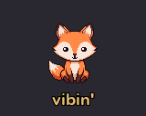
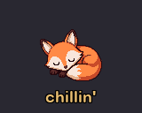

# MiniToo for macOS

Give a Divoom MiniToo three jobs: show what your AI is doing, run a focus timer,
and receive messages from a browser.

| Character status | Focus timer | Live Studio |
| --- | --- | --- |
| Fox or dino faces for working, waiting and chilling | A countdown with optional Apple Music playback | Colored text and emoji from your Mac or an authorized phone |

| Working | Waiting | Chilling |
| :---: | :---: | :---: |
|  |  |  |

## Get started

You need macOS, Python 3.9 or newer, Xcode Command Line Tools, and a MiniToo
paired in System Settings. The original apps were tested on firmware 2.4.0.

```bash
git clone https://github.com/clea-mahoney/minitoo.git
cd minitoo
./setup.sh
./minitoo setup
./minitoo face working
./minitoo codex install   # optional automatic faces in Codex
```

Allow Bluetooth access for `divoom-send` when macOS asks. Close the Divoom phone
app and disconnect the phone from the MiniToo during setup.

The face installer asks for your Divoom login in your terminal. It uses the
account to discover your three custom face IDs. Passwords and login tokens are
not saved; device settings go in `~/.clauddy/config`.

## Use it

```bash
./minitoo character fox                 # upload fox faces; dino is also included
./minitoo face chilling                 # switch to an already-installed face
./minitoo pomodoro 25 5 1 --no-music     # one 30-minute cycle, including the break
./minitoo studio on                     # local controller: http://127.0.0.1:8765
./minitoo studio off                    # restore the previous face
./minitoo send picture.png              # send an image or GIF
./minitoo status
```

Character changes upload three GIFs and take longer than ordinary face switches.
Studio owns the screen until it is turned off. It sends messages over the open
Bluetooth connection and leaves character artwork intact. The controller reports
transfer acknowledgement separately from the screen's visual appearance.

For music during Pomodoro, install `switchaudio-osx` and start a playlist in
Music once. Omit `--no-music` to let the timer route it to the MiniToo. Keep the
launching terminal or chat open until the timer ends. The device's physical
return button exits the countdown view.

## Guides

- [Setup and automatic status hooks](docs/setup.md)
- [Pomodoro and optional music](apps/pomodoro/README.md)
- [Live Studio and phone access](apps/live-studio/README.md)
- [Troubleshooting](docs/troubleshooting.md)
- [Bluetooth implementation](docs/protocol.md)
- [Release verification](docs/verification.md)

`core/` handles Bluetooth and media. `apps/` contains the three applications.
Personal settings, message logs, compiled binaries and development history are
not included in this source distribution.

## Credits and license

The new media sender implements the animation format documented by
[alvinunreal/divoom-minitoo-osx](https://github.com/alvinunreal/divoom-minitoo-osx).
It reuses this project's Bluetooth helper; it does not bundle Alvin's source.

Source code is available under the [MIT license](LICENSE). Character artwork is
included as project assets; the MIT code license does not grant a separate
artwork license. No vendor SDK or firmware is bundled.

This project is not affiliated with Divoom.
